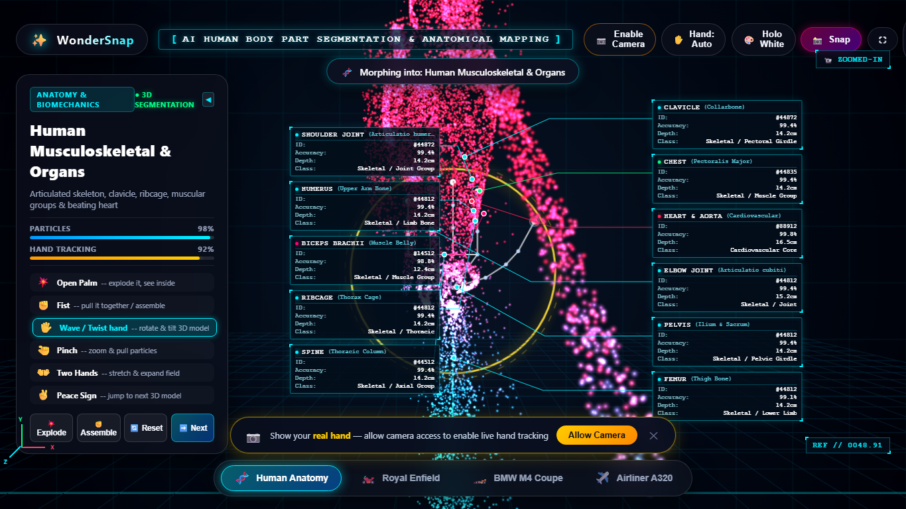
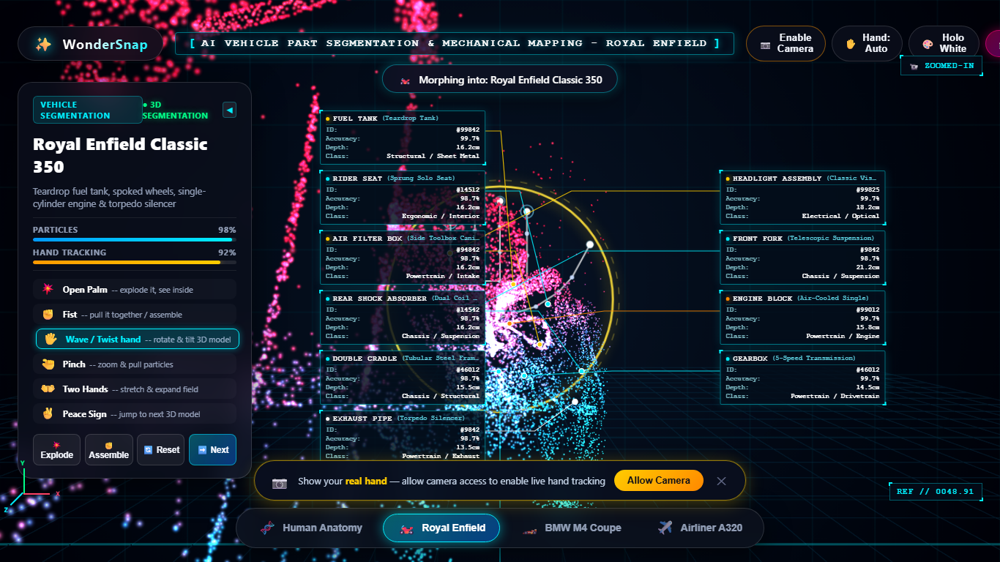
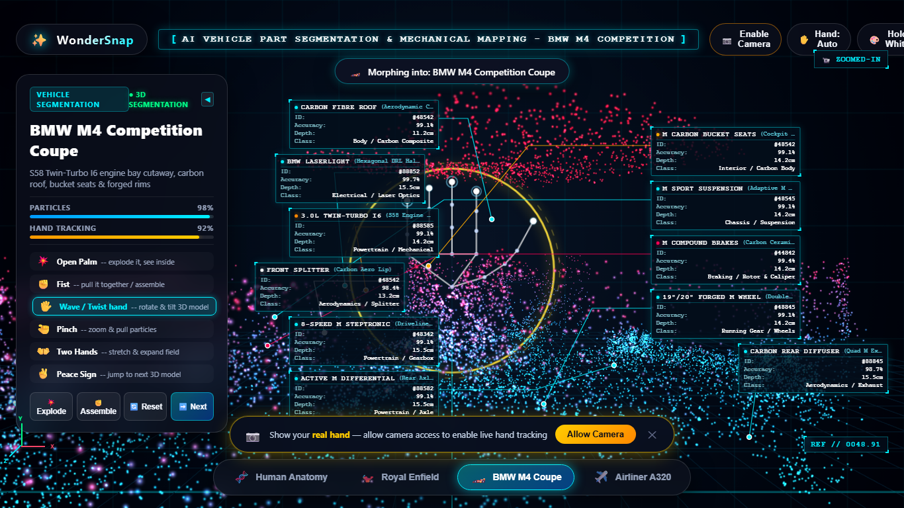
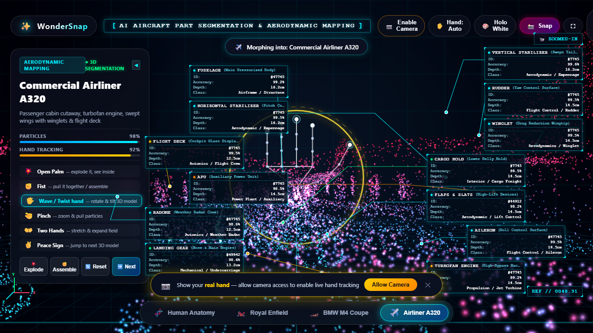

# 🌌 WonderSnap 3D — In-Browser Holographic Particle Experience & AI Vision Blueprint

[](https://threejs.org/)
[](https://ai.google.dev/edge/mediapipe/solutions/vision/hand_landmarker)
[](https://www.khronos.org/webgl/)
[](https://vitejs.dev/)
[](https://opensource.org/licenses/MIT)

> **WonderSnap 3D** is a futuristic, interactive **3D holographic particle experience** running entirely client-side in the browser. Powered by **Google MediaPipe Tasks Vision** for zero-latency AI hand tracking and **Three.js custom GLSL particle shaders**, it renders **16,384 GPU particles** across four photorealistic technical blueprints with real-time part segmentation, dynamic dog-leg connector lines, exploded cutaway views, and an authentic sci-fi blueprint HUD.

---

## 📸 Technical Blueprint Showcase

| 🧬 Human Musculoskeletal & Organs | 🏍️ Royal Enfield Classic 350 |
| :---: | :---: |
|  |  |
| *Full skeletal frame, ribcage, spine, and beating heart* | *Teardrop tank, 36-spoke wheels, engine block & torpedo exhaust* |

| 🏎️ BMW M4 Competition Coupe | ✈️ Commercial Airliner A320 |
| :---: | :---: |
|  |  |
| *S58 Twin-Turbo I6 cutaway, carbon roof, M bucket seats & forged rims* | *Flight deck cutaway, cabin seats, turbofan engines & winglets* |

---

## 📑 Table of Contents
1. [Key Features](#-key-features)
2. [The 4 Technical Blueprint Models](#-the-4-technical-blueprint-models)
3. [Sci-Fi Technical Blueprint HUD](#-sci-fi-technical-blueprint-hud)
4. [AI Computer Vision & Gesture Recognition](#-ai-computer-vision--gesture-recognition)
5. [GPU Particle Engine & GLSL Shaders](#-gpu-particle-engine--glsl-shaders)
6. [Virtual Cyber Hand (Simulation Fallback)](#-virtual-cyber-hand-simulation-fallback)
7. [System Architecture & Codebase Map](#-system-architecture--codebase-map)
8. [Setup & Installation Guide](#-setup--installation-guide)
9. [Privacy & Security Notice](#-privacy--security-notice)
10. [License](#-license)

---

## 🌟 Key Features

- 📸 **Client-Side Video Feed**: Integrates your natural webcam feed as the holographic backdrop with natural lighting and zero cloud dependencies.
- 🖐️ **21-Landmark Real-Time Hand Tracking**: Powered by Google MediaPipe Tasks Vision (WebAssembly + SIMD) tracking 21 3D joint landmarks per hand at 60 FPS.
- ⚡ **16,384 GPU Particle System**: Custom GLSL vertex and fragment shaders orchestrate real-time morphing, exploded views, and particle vortices.
- 📐 **CAD-Inspired Blueprint HUD**:
  - Dynamic top header title banner syncing with each selected model.
  - 3D perspective floor grid with origin coordinate axes (`X: Red`, `Y: Green`, `Z: Blue`).
  - Collision-free vertical callout cards with `ID:`, `Accuracy:`, `Depth:`, and `Class:`.
  - Dynamic 3-point dog-leg SVG lines anchored directly to 3D model landmarks.
  - Collapsible inspector card (`◀` / `▶`) for an unobstructed view of the blueprint.
- 💥 **Exploded Assembly & Singularity Modes**: Explode sub-assemblies outward to inspect internal organs, engine blocks, or passenger cabin rows; implode particles into a spinning core.
- 🎮 **Virtual Cyber Hand Fallback**: Full interactive simulation via mouse and keyboard when a webcam is not available.

---

## 🔬 The 4 Technical Blueprint Models

Each 3D model is mathematically synthesized with 16,384 spatial particle coordinates:

### 1. 🧬 Human Musculoskeletal & Anatomical Mapping
- **Banner Title**: `AI HUMAN BODY PART SEGMENTATION & ANATOMICAL MAPPING`
- **Sub-Assemblies**: Cranium skull, clavicles (collarbone), shoulder ball-and-socket joints, 12 rib pairs, S-curve spinal column, beating heart core with aortic arch, biceps brachii, humerus, pelvis, and femur thigh bone.
- **Callouts**: 11 HUD callouts with dynamic SVG connector lines.

### 2. 🏍️ Royal Enfield Classic 350 Mechanical Mapping
- **Banner Title**: `AI VEHICLE PART SEGMENTATION & MECHANICAL MAPPING - ROYAL ENFIELD`
- **Sub-Assemblies**: Teardrop fuel tank with rubber knee grips, 36-spoke wire rims, air-cooled single-cylinder engine with horizontal cooling fins, crankcase sump, torpedo silencer exhaust pipe, sprung solo rider seat, double cradle frame, telescopic front fork, and headlight visor cowl.
- **Callouts**: 10 HUD callouts with dynamic SVG connector lines.

### 3. 🏎️ BMW M4 Competition Coupe Mechanical Mapping
- **Banner Title**: `AI VEHICLE PART SEGMENTATION & MECHANICAL MAPPING - BMW M4 COMPETITION`
- **Sub-Assemblies**: S58 3.0L Twin-Turbo Inline-6 cutaway with carbon V-strut brace, vertical kidney grilles, laser headlights, front aero splitter, dual M Carbon bucket seats, carbon fiber roof with aerodynamic channel, 19"/20" forged star-spoke M wheels, cross-drilled carbon brakes, and quad exhausts with carbon rear diffuser.
- **Callouts**: 11 HUD callouts with dynamic SVG connector lines.

### 4. ✈️ Commercial Airliner A320 Aerodynamic Mapping
- **Banner Title**: `AI AIRCRAFT PART SEGMENTATION & AERODYNAMIC MAPPING`
- **Sub-Assemblies**: Radome weather radar nose cone, cockpit flight deck cutaway with pilot seating, passenger cabin cutaway with 14 seat rows and center aisle, lower belly cargo hold, tail APU turbine generator, swept wings with winglets and flaps/slats, CFM turbofan engines with spinning fan blades, landing gear, and vertical stabilizer tail fin with rudder.
- **Callouts**: 13 HUD callouts with dynamic SVG connector lines.

---

## 📐 Sci-Fi Technical Blueprint HUD

* **Collision Avoidance Layout**:
  * Projects 3D model vertices to 2D screen coordinates using camera view-projection matrices:
    $$\mathbf{v}_{\text{screen}} = \text{Project}(\mathbf{M}_{\text{proj}} \times \mathbf{M}_{\text{view}} \times \mathbf{v}_{\text{world}})$$
  * Sorts callouts vertically by their projected $Y$ anchor position and distributes them across screen bounds with guaranteed non-overlapping spacing.
  * Renders 3-point dog-leg SVG connector lines: $(\text{Anchor}_X, \text{Anchor}_Y) \to (\text{Elbow}_X, \text{Target}_Y) \to (\text{Card}_X, \text{Target}_Y)$.
* **HUD Corner Accents**: Top-right camera `zoomed-in` targeting box, bottom-left 3D coordinate axis widget, and bottom-right target reference coordinate telemetry.
* **Collapsible Inspector**: Click `◀` / `▶` to minimize the left control card into a slim tab, granting an unobstructed full-screen technical view.

---

## 🖐️ AI Computer Vision & Gesture Recognition

Powered by **MediaPipe Tasks Vision** (`HandLandmarker`), WonderSnap tracks 21 distinct 3D knuckle joints per hand:

| Gesture | Real-Time Action | Mathematical Rule |
| :--- | :--- | :--- |
| **Open Palm 💥** | **Exploded View** | All 4 fingertips extended above PIP joints ($y_{\text{tip}} < y_{\text{pip}}$). |
| **Fist ✊** | **Assemble Core** | All 4 fingertips curled below MCP joints ($y_{\text{tip}} > y_{\text{mcp}}$). |
| **Wave / Tilt 🖐️** | **3D Rotation** | Average hand position normalized against screen center $(\Delta x, \Delta y)$ drives pitch and yaw. |
| **Pinch 🤏** | **Zoom & Scale** | Euclidean distance between Thumb Tip (#4) and Index Tip (#8) scales size ($0.5\times$ to $2.5\times$). |
| **Two Hands 👐** | **Stretch Field** | Distance between left and right hand centers stretches coordinates. |
| **Peace Sign ✌️** | **Cycle 3D Models** | Index (#8) & Middle (#12) extended in a V with Ring & Pinky curled. |
| **Thumbs Up 👍** | **Capture Snapshot** | Thumb extended vertically ($y_4 < y_3 - \delta$) with all other fingers curled; captures high-res PNG. |

* **Smoothing**: Applied via Exponential Moving Average (EMA) to prevent jitter:
  $$\mathbf{x}_{\text{smoothed}}[t] = \alpha \mathbf{x}[t] + (1 - \alpha) \mathbf{x}_{\text{smoothed}}[t - 1]$$

---

## ⚡ GPU Particle Engine & GLSL Shaders

WonderSnap utilizes custom **GLSL vertex and fragment shaders** to manipulate 16,384 points simultaneously on the GPU:

- **Morph Interpolation**: Smooth cubic Hermite interpolation between models based on `uMorphFactor`.
- **Exploded View**: Radial blast vector normalized from model origin:
  ```glsl
  vec3 radialDir = normalize(p + vec3(0.001));
  p += radialDir * (uExplode * (1.6 + aSeed.x * 1.8));
  ```
- **Attractor Vortex**: Swirls particles around the user's hand using a cross-product vortex pull.
- **Fragment Core Glow**: Exponential glow core with distance falloff:
  $$I = 1.5 e^{-8.5 r} + 0.55 \cdot \text{smoothstep}(0.5, 0.0, r)$$

---

## 🎮 Virtual Cyber Hand (Simulation Fallback)

If a webcam is unavailable or permissions are denied, WonderSnap provides an interactive mouse and keyboard simulation:

* **Mouse Movement**: Directs the 3D hand attractor and tilts the model.
* **Left Click (Hold)**: Assembles the model into a dense core (Fist ✊).
* **Right Click (Hold)**: Triggers the exploded assembly view (Open Palm 💥).
* **Scroll Wheel**: Smooth pinch zoom.
* **Keys `1` / `2` / `3` / `4`**: Jump directly to Human, Bike, Car, or Plane.
* **Key `P`**: Cycle holographic color palettes.
* **Key `S` / Space**: Capture high-resolution snapshot.
* **Key `F`**: Fullscreen toggle.

---

## 🏗️ System Architecture & Codebase Map

```
wondersnap/
├── index.html                 # Main HUD layout, blueprint banner, canvas layers
├── vite.config.js             # Vite configuration with watch filtering
├── package.json               # Dependencies & scripts
├── README.md                  # Comprehensive GitHub documentation
├── assets/                    # Showcase screenshots & preview imagery
│   ├── blueprint-human.png    # Human Anatomy blueprint capture
│   ├── blueprint-bike.png     # Royal Enfield blueprint capture
│   ├── blueprint-car.png      # BMW M4 Coupe blueprint capture
│   └── blueprint-plane.png    # Commercial Airliner blueprint capture
└── src/
    ├── main.js                # Application coordinator & event binder
    ├── style.css              # Technical blueprint styling, HUD overlay, animations
    ├── models/
    │   └── modelGenerators.js # 16.4K particle geometry generators (Human, Bike, Car, Plane)
    ├── modules/
    │   ├── camera.js          # Resilient webcam streaming with auto-fallback
    │   ├── handTracker.js     # MediaPipe HandLandmarker & cybernetic gold halo overlay
    │   ├── gestures.js        # Mathematical gesture detection & smoothing (EMA)
    │   ├── labels.js          # Blueprint HUD cards & dynamic dog-leg SVG lines
    │   ├── scene.js           # Three.js WebGL scene, floor grid, morphing shader controller
    │   ├── ui.js              # Glassmorphic inspector card, dock buttons, telemetry
    │   ├── snapshot.js        # Off-screen compositor & shutter flash PNG exporter
    │   └── effects.js         # Color palettes & particle dynamics
    └── shaders/
        └── particleShaders.js # High-performance GLSL vertex & fragment particle shaders
```

---

## 🚀 Setup & Installation Guide

### Prerequisites
* **Node.js**: `v18.0.0` or higher
* **npm**: `v9.0.0` or higher
* **Modern Browser**: Google Chrome, Microsoft Edge, or Chromium (hardware acceleration recommended)
* **Webcam**: Built-in or USB webcam (optional; interactive simulation fallback available)

### Step 1: Clone the Repository
```bash
git clone https://github.com/puneethkumarj2007/Gesture-Controlled-3d-praticale-web-app.git
cd Gesture-Controlled-3d-praticale-web-app
```

### Step 2: Install Dependencies
```bash
npm install
```

### Step 3: Run the Development Server
```bash
npm run dev
```

Visit **`http://localhost:5173/`** in your browser.

### Step 4: Build for Production
```bash
npm run build
npm run preview
```

> **Tip for Chrome Users**: To automatically bypass the camera permission prompt for kiosk/demo mode:
> ```bash
> chrome.exe --use-fake-ui-for-media-stream http://localhost:5173/
> ```

---

## 🔒 Privacy & Security Notice

* **100% Client-Side Processing**: MediaPipe Tasks Vision and Three.js run completely inside your local browser.
* **No Video Uploads**: Video frames from your webcam are processed directly in GPU/WASM memory on your device and are **never** transmitted, stored, or sent to external servers.
* **No Secrets / No API Keys**: This application requires no third-party API keys, environment credentials, or cloud subscriptions to run.

---

## 📜 License

Distributed under the **MIT License**. See `LICENSE` for details. Free for open-source exploration, learning, and customization.

---

⭐ **If you find this project inspiring, please consider starring the repository!**
